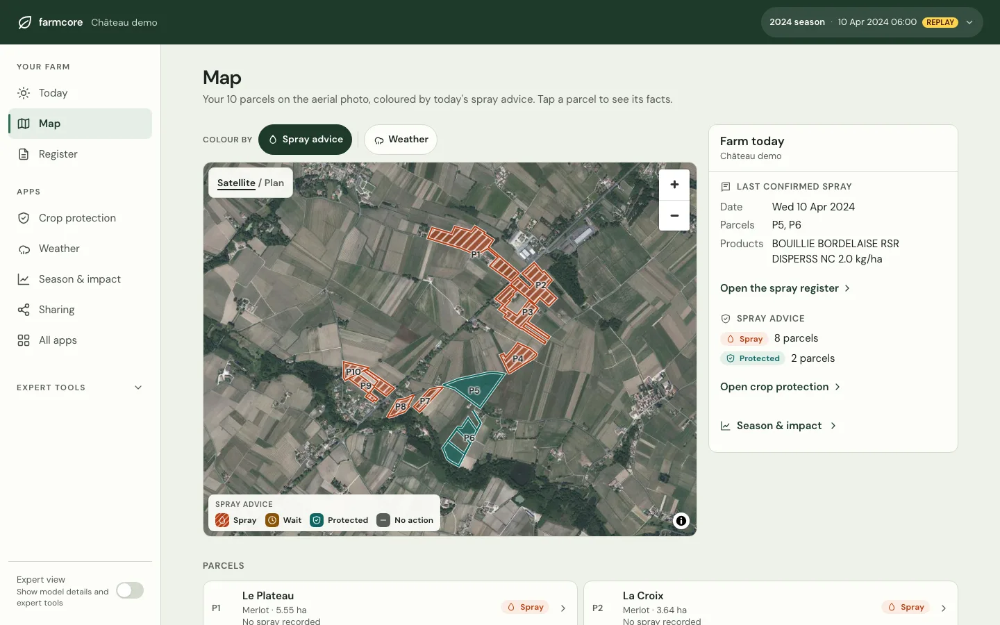

<p align="center">
  
</p>

<h1 align="center">FarmCore</h1>

<p align="center">
  <b>Know when to spray. Record it once.</b><br>
  Open, farmer-controlled farm data.
</p>

<p align="center">
  <a href="https://farmcore.lucasreed.me"><b>Website</b></a> ·
  <a href="https://agri.lucasreed.me/">Live demo</a> ·
  <a href="docs/self-hosting.md">Self-hosting</a> ·
  <a href="docs/architecture.md">Architecture</a>
</p>

<p align="center">
  <a href="https://github.com/LucasGeno/farmcore/actions/workflows/ci.yml"></a>
  <a href="LICENSE"></a>
  
</p>

<p align="center">
  
  <br><sub>The demo estate on 10 April 2024: eight parcels to spray, two still protected. Aerial imagery © IGN.</sub>
</p>

FarmCore is a small modular core with installable apps:
it brings a farm's parcels, weather, operations and machine files into one place the farmer
controls, explains every piece of advice it gives, and shares data with third parties only under
scoped, revocable, logged consent.

The first apps target vineyards: a mildew spray advisor, a voice-first spray log over Telegram
and an EU spray register.

> Status: **0.1, early.** Not validated with farmers or agronomists; thresholds marked
> "assumed" still need review. The advice is decision support: product labels and local rules
> always take precedence.

FarmCore began at the EU Agri-Hackathon 2026.

## Features

- **Crop protection advisor.** Downy mildew (3-10 rule, Goidanich incubation), powdery mildew
  (Gubler–Thomas), protection length, rain wash-off and spray windows: spray / wait / protected
  per parcel, each with its rule, thresholds and published source. Assumed values are labelled.
- **Map and parcels.** Aerial map (IGN orthophotos or OpenStreetMap) with layers contributed by
  apps; a parcel workspace with advice, season history and activity.
- **Spray log by voice or text.** Telegram or the web assistant: "Sprayed P5 and P6 with copper,
  2 kg" becomes a draft entry the farmer confirms. Speech is transcribed on the server
  (faster-whisper); an optional Gemini extractor fills the draft, with a local parser as
  fallback.
- **Records.** The Regulation (EU) 2023/564 plant-protection register with record checks
  (label limits, copper per season), CSV / JSON export and ISOXML TaskData import that merges
  machine files with voice logs.
- **Weather and forecast.** Météo-France station ingest, spray conditions per hour, a five-day
  spray plan from archived forecast runs.
- **Consent-based sharing.** Read-only, revocable grants by scope, an access log of every read,
  and a FIWARE NGSI-LD export.
- **Season & impact.** Replays a season against a calendar spray programme and the Agreste
  regional reference: treatments, copper, diesel and CO₂ avoided, with every assumption shown.
- **Modular.** Apps declare routes, jobs, scopes, map layers and Today widgets in a manifest;
  optional ones switch on and off at `/apps`.

The demo replays the 2024 season on a fictional Bordeaux estate built from open data: ten real
IGN vine parcels near Saint-Émilion and Météo-France station 33394002.

## Quick start

Requires Python 3.12, [uv](https://docs.astral.sh/uv/) and Docker.

```sh
git clone https://github.com/LucasGeno/farmcore.git && cd farmcore
cp .env.example .env
docker compose -f docker-compose.dev.yml up -d db     # PostGIS on localhost:55442
uv sync
uv run farmcore migrate
uv run farmcore seed --scene B                         # the open-data demo farm
uv run uvicorn farmcore.main:create_app --factory --reload
```

Open <http://localhost:8000>. With `ADMIN_TOKEN` unset, every visitor is administrator: local
use only. Step the replay clock from the header, or `uv run farmcore replay --to "2024-04-10 06:00"`.

On Apple silicon, set `POSTGIS_IMAGE=imresamu/postgis:17-3.5` first (the default image is
amd64-only).

## Self-hosting

`docker-compose.yml` runs the app, an optional Telegram bot, PostgreSQL + PostGIS and a daily
backup, and refuses to start without a strong admin token:

```sh
cp .env.example .env    # set POSTGRES_PASSWORD and ADMIN_TOKEN
docker compose up -d --build
docker compose exec app farmcore seed --scene B
```

Read [docs/self-hosting.md](docs/self-hosting.md) and [SECURITY.md](SECURITY.md) first: there
is one administrator per installation, and anonymous visitors can read everything the
installation holds.

## Documentation

- [Architecture](docs/architecture.md): core, apps, data model, AI boundary
- [Self-hosting](docs/self-hosting.md): configuration, reverse proxy, Telegram, Vertex AI, backups
- [Contributing](CONTRIBUTING.md): development setup, tests, writing an app
- [Security](SECURITY.md): access model and reporting vulnerabilities
- [Third-party licences and data sources](THIRD_PARTY_NOTICES.md)

## Licence

FarmCore is licensed under the [Apache License 2.0](LICENSE). Bundled third-party libraries,
fonts and open data keep their own licences: see [NOTICE](NOTICE) and
[THIRD_PARTY_NOTICES.md](THIRD_PARTY_NOTICES.md).
