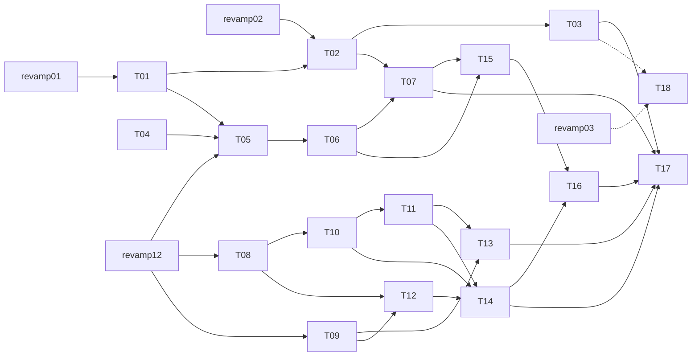

# Implementation graph

**Source:** [Change Spec, revision 2](spec.md). Publishing this graph does not mean any work is complete or deployed.

Revision 2 replaces the original 20-ticket graph. That graph put 13 tickets in a row and made the fertilization app wait on customer suspension. Revision 2 has four parallel tracks with few cross-edges, plus one deferred hosting track. After revamp 12 the longest chain is six tickets (for example 08 → 10 → 11 → 14 → 16 → 17).

## Tickets

| Ticket | Track | Blocked by |
|---|---|---|
| [01 — Run two isolated installations from one release](tickets/01-portable-installations.md) | A portable | revamp01 |
| [02 — Back up and restore an installation into an independent copy](tickets/02-backup-restore.md) | A portable | 01, revamp02 |
| [03 — Upgrade through one migrator with a tested recovery path](tickets/03-safe-upgrades.md) | A portable | 02 |
| [04 — Spike: choose the Postgres task library](tickets/04-task-queue-spike.md) | B background | — |
| [05 — Run the live forecast fetch as a durable, fenced task](tickets/05-durable-forecast-task.md) | B background | 01, 04, revamp12 |
| [06 — Move station ingest and advisor evaluation onto durable tasks](tickets/06-durable-job-adoption.md) | B background | 05 |
| [07 — Dispatch notifications through a transactional outbox](tickets/07-notification-outbox.md) | B background | 02, 06 |
| [08 — Add neutral catalog items and typed quantities](tickets/08-catalog-quantity-expand.md) | C domain | revamp12 |
| [09 — Retain distinct crop seasons on a stable parcel](tickets/09-crop-seasons.md) | C domain | revamp12 |
| [10 — Move records and capture onto the neutral catalog](tickets/10-record-consumer-migration.md) | C domain | 08 |
| [11 — Keep stock accounting exact through neutral quantities](tickets/11-inventory-consumer-migration.md) | C domain | 10 |
| [12 — Keep crop-protection assessments typed and reproducible](tickets/12-assessment-consumer-migration.md) | C domain | 08, 09 |
| [13 — Record fertilization through an optional in-tree app](tickets/13-fertilization-records.md) | C domain | 09, 11 |
| [14 — Remove crop-protection assumptions from shared core](tickets/14-neutral-core-contract.md) | C domain | 10, 11, 12 |
| [15 — Make module disablement effective across processes](tickets/15-module-lifecycle.md) | D modules | 06, 07 |
| [16 — Install an externally packaged threshold-alert app](tickets/16-external-threshold-alerts.md) | D modules | 14, 15 |
| [17 — Qualify the integrated self-hostable release](tickets/17-integration-qualification.md) | Final | 03, 07, 13, 14, 16, revamp12 |
| [18 — Operate hosted installations from a declarative inventory](tickets/18-hosted-fleet.md) | E hosting, **deferred** | 03, revamp03 |

## Execution order

1. **Now:** start ticket 04 (throwaway spike). Prepare ticket 01 on an isolated branch; it qualifies once revamp 01 lands.
2. **After revamp 02:** tickets 02 → 03. Self-hosters can then move and upgrade installations safely, whether or not anyone hosts for them.
3. **After revamp 12:** run tracks B (05–07) and C (08–14) in parallel worktrees. Fertilization (13) can ship before the contract step (14).
4. **Then:** track D (15–16), then 17.
5. **Ticket 18 starts only when its trigger fires** (see the spec's Deferred table). The customer portal, signup and payments have no tickets on purpose.

## Execution rules

These apply to every ticket. They are stated here once instead of being copied into each ticket.

- **Ownership.** One worker owns a ticket's slice. Preserve peers' edits. Draft code inherited from another branch is not a completed dependency.
- **TDD.** Work through the public seams (CLI, HTTP, worker, package): observe the failing behaviour, write the minimum to pass, then refactor. Mock only external infrastructure and providers.
- **Migrations.** Core has one linear chain. Only the integration coordinator authors and serializes core revision files; workers propose schema changes. External apps (ticket 16 onward) carry their own Alembic branch rooted on a core revision (spec D5).
- **Safety limits.** No live customer data, real provisioning, payments, production migrations or deployments.
- **Tiers.** Tier 3, as defined in the spec's testing approach, applies where a ticket says so. Report skipped layers honestly.
- **Review.** Before merge, an independent reviewer checks spec conformance and standards separately, on a frozen SHA. Focused checks never claim the final qualification (17).
- **Existing PRs.** Current revamp PRs keep their own gates. This graph does not redirect their file ownership.

## Mapping from revision 1

| Rev 1 | Rev 2 | Change |
|---|---|---|
| 01 | 01 | Adds the idle-cost measurement, the single `migrate` service and a least-privilege role |
| 02 | 02 | Uses a pg_dump bundle with no cross-store snapshot (D2); adds the `external_effects` pause |
| 03, 04, 06 | 18 | Merged into declarative fleet tooling; deferred behind a trigger; portal dropped |
| 05 | 03 | Upgrade no longer depends on hosting provisioning |
| 07, 08 | 04, 05, 06 | Adopts a library after a spike (D3); replay stays in-process |
| 09 | 07 | No longer blocked by suspension; uses the pause flag from 02; targets the real effect (`chat.push_advice`) |
| 10 | 15 | Unchanged intent; the customer configuration flow is dropped |
| 11, 18 | 16 | One external package proves the contract; adds an Alembic branch (D5) |
| 12–17 | 08–12, 14 | Unchanged intent; no longer blocked by the addon contract; 14 now decouples forecast, chat, kpi, notifications and assistant from advisor |
| 19 | 13 | In-tree; blocked only by seasons and inventory |
| 20 | 17 | Hosting removed from final qualification |
